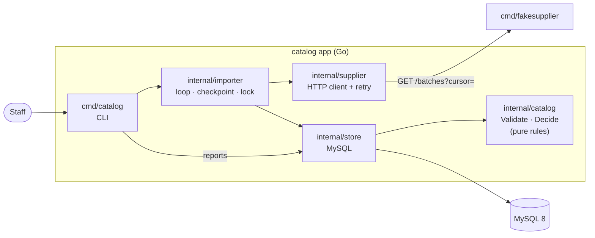
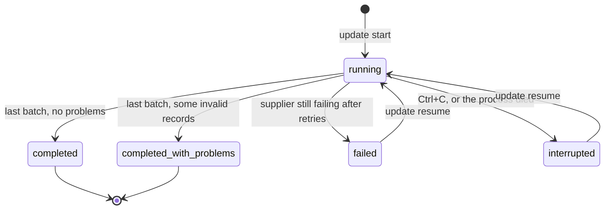

# Supplier Catalog Updates

A small command-line system that keeps a product catalog in sync with a
supplier. The supplier sends its data in batches that may be repeated or
arrive out of order, and the connection may fail at any time. Staff can
start an update, see whether it finished, what it changed and what still
needs attention, and resume an update that stopped half-way, without ever
losing or corrupting the existing catalog.

Written in Go 1.27 with MySQL 8 (Docker). A fake supplier is included.

- [Requirements](#requirements)
- [Quick start](#quick-start)
- [CLI commands](#cli-commands)
- [Failure scenarios demo](#failure-scenarios-demo)
- [Design](#design)
- [Assumptions](#assumptions)
- [Running the tests](#running-the-tests)
- [Not done yet / next steps](#not-done-yet--next-steps)

## Requirements

- Go 1.27 or newer
- Docker Desktop (for MySQL 8)

## Quick start

```sh
docker compose up -d                                       # MySQL on localhost:3307
go run ./cmd/catalog migrate                               # create the tables
go run ./cmd/fakesupplier -feed testdata/feeds/initial     # terminal 1: the supplier on :8081
go run ./cmd/catalog update start                          # terminal 2: run an update
go run ./cmd/catalog products                              # see the catalog
```

`docker compose ps` should show the database as `healthy` before you run
`migrate`. (`catalog` also waits up to 30 seconds for MySQL to come up.)

Configuration is read from environment variables:

| Variable | Default |
|---|---|
| `CATALOG_DSN` | `admin:admin@tcp(127.0.0.1:3307)/coderpush_db?parseTime=true&loc=UTC&charset=utf8mb4` |
| `SUPPLIER_URL` | `http://localhost:8081` (or `-supplier URL` on `update start/resume`) |

## CLI commands

| Command | What it does |
|---|---|
| `catalog migrate` | Create the database tables (safe to run again). |
| `catalog update start [-supplier URL]` | Start a new update. Refused while another update is unfinished. |
| `catalog update resume [-supplier URL]` | Continue the unfinished update from its last checkpoint. |
| `catalog update status [-run ID]` | Is the update finished? What did it change? Default: the latest run. |
| `catalog update list [-limit N]` | Recent updates and their status. |
| `catalog changes [-run ID] [-kind KIND]` | Every change of a run: `created`, `updated`, `withdrawn`, `reactivated`. |
| `catalog problems [-all]` | What needs attention: an unfinished update, and records that could not be applied. |
| `catalog problems resolve ID` | Mark a problem as handled. |
| `catalog products [-status STATUS] [-sku SKU]` | The catalog (`active` / `withdrawn`). |

`update start` and `update resume` also accept `-crash-after-batch N`,
which kills the process right after batch N is committed, to demonstrate
crash recovery.

Example of `catalog update status` after the supplier went down:

```
Run #2   Status: failed (NOT FINISHED)
Started:      2026-10-22 15:20:56 UTC
Last update:  2026-10-22 15:21:13 UTC
Finished:     -
Applied:      2 batches
Changes:      1 created, 3 updated, 3 withdrawn, 0 reactivated
Skipped:      3 stale, 2 duplicate
Problems:     2 invalid records (2 unresolved)
Last error:   supplier unavailable after 5 attempts: supplier returned HTTP 503: ...
→ The catalog keeps every batch applied so far. Run `catalog update resume` to continue.
```

The fake supplier (`go run ./cmd/fakesupplier`) accepts:

| Flag | Default | Meaning |
|---|---|---|
| `-addr` | `:8081` | Listen address |
| `-feed` | `testdata/feeds/initial` | Directory of batch files, served in file name order |
| `-fail-at N` | `0` (off) | Batch N answers `503` |
| `-fail-times K` | `0` (forever) | How many times `-fail-at` fails before recovering |
| `-fail-rate P` | `0` | Probability of a random `503` on any request |
| `-delay D` | `0` | Wait before each answer (e.g. `2s`), handy to press Ctrl+C mid-update |

## Failure scenarios demo

Two terminals in the project directory. Start from an empty database
(`docker compose down -v && docker compose up -d`, then `migrate`).

```sh
# 1. First update
#    terminal 1:
go run ./cmd/fakesupplier -feed testdata/feeds/initial
#    terminal 2:
go run ./cmd/catalog update start          # completed, 10 products created
go run ./cmd/catalog products

# 2. The supplier goes down in the middle of an update
#    terminal 1 (Ctrl+C first):
go run ./cmd/fakesupplier -feed testdata/feeds/changes -fail-at 3
#    terminal 2:
go run ./cmd/catalog update start          # retries ~15 s, then: failed after 2 batches
go run ./cmd/catalog update status         # NOT FINISHED
go run ./cmd/catalog products              # batches 1-2 applied, nothing lost
go run ./cmd/catalog update start          # refused: resume the open update first

# 3. The supplier is back: resume
#    terminal 1 (Ctrl+C first):
go run ./cmd/fakesupplier -feed testdata/feeds/changes
#    terminal 2:
go run ./cmd/catalog update resume         # fetches batch 3 only -> completed_with_problems
go run ./cmd/catalog changes -run 2        # what changed, old -> new
go run ./cmd/catalog problems              # 3 invalid records from the supplier

# 4. Import the same data again
go run ./cmd/catalog update start          # 0 changes, no duplicate products

# 5. The app crashes mid-update
go run ./cmd/catalog update start -crash-after-batch 1
go run ./cmd/catalog update status         # interrupted (the process is gone)
go run ./cmd/catalog update resume         # continues from batch 2
```

The `changes` feed covers every tricky case: a new product, a price
change, a withdrawal, exact duplicates, an older record arriving after a
newer one (in the same batch and in a later batch), a withdrawal arriving
before the product was ever created, an old record of a withdrawn product
(ignored), a newer record of a withdrawn product (reactivated), and
invalid records (missing name, negative price, `version = 0`).

## Design

### Components



- `internal/catalog` has the business rules and no I/O at all, so it is
  tested with plain tables.
- `internal/store` and `internal/supplier` depend only on `internal/catalog`.
- `internal/importer` ties them together; `cmd/*` only wire and print.

### One batch = one transaction

For each batch, `store.ApplyBatch` does, in a single MySQL transaction:

1. lock the run row and check the run is still running;
2. record the batch id in `applied_batches` (a repeated batch is detected
   here and only moves the checkpoint);
3. `SELECT ... FOR UPDATE` the current state of every SKU in the batch;
4. validate and decide each item **in batch order**, applying each decision
   to an in-memory map so a later item of the same SKU is compared with the
   newest state;
5. upsert the changed products, insert the `changes` and `problems` rows;
6. move the run's checkpoint (`next_cursor`) and counters;
7. on the last batch (`has_more = false`), mark the run completed;
8. `COMMIT`.

The catalog and the checkpoint are committed together. If the process dies
before `COMMIT`, MySQL rolls the whole batch back and the checkpoint still
points at it: resuming fetches it again. If it dies after `COMMIT`, the
batch is fully recorded and resuming starts at the next one. A run is
marked completed in the same transaction as its last batch, so it can
never be reported complete while work is missing.

### Run lifecycle



`failed`, `interrupted` and `running` runs are *open*. At most one run is
open: `start` checks for an open run while holding the import lock below,
and refuses (pointing to `resume`) if there is one.

Only one process may import at a time: it holds the MySQL named lock
`GET_LOCK('catalog-import')` on a dedicated connection for the whole run.
If the process dies, MySQL closes the connection and frees the lock. So
a run still marked `running` while the lock is free belongs to a dead
process: `update status` shows it as `interrupted`, and the next
`start`/`resume` records it as such.

Supplier errors are retried 5 times with exponential backoff (1 s, 2 s,
4 s, 8 s, plus jitter) for network errors, `5xx` and `429`. Other `4xx`
fail at once. The client also rejects answers that would corrupt the
import, such as `has_more = true` with an empty `next_cursor`.

### Decision table

Each record carries a supplier `version`. Only a strictly greater version
can change a product.

| # | Stored product | Incoming record | Action | Recorded as |
|---|---|---|---|---|
| 1 | any | invalid | skip | `problems` |
| 2 | unknown SKU | for sale | Create | change `created` |
| 3 | unknown SKU | withdrawn | Create tombstone | change `withdrawn` |
| 4 | version 5 | version 3 | Skip (stale) | counter `skipped_stale` |
| 5 | version 5 | version 5 | Skip (duplicate) | counter `skipped_duplicate` |
| 6 | active, v5 | v6 for sale | Update | change `updated` (*) |
| 7 | active, v5 | v6 withdrawn | Withdraw | change `withdrawn` |
| 8 | withdrawn, v5 | v4 for sale | Skip (stale): **not revived** | counter `skipped_stale` |
| 9 | withdrawn, v5 | v6 for sale | Reactivate | change `reactivated` |
| 10 | withdrawn, v5 | v7 withdrawn | Bump tombstone version | – |

(*) If the content is identical, only the version moves; no change is logged.

Row 10 matters: if the supplier's real history is v5 withdraw, v6 back on
sale, v7 withdraw, and v6 arrives last, the tombstone must already be at v7
so that v6 is recognised as stale.

Because the outcome depends only on the highest version per SKU, applying
the batches of a feed in any order gives the same catalog (tested).

### Data model

| Table | Purpose |
|---|---|
| `products` | The catalog. Withdrawn products stay as tombstones. Never deleted. |
| `import_runs` | One row per update: status, checkpoint, counters, last error. |
| `applied_batches` | Batch ids applied by each run, to ignore a repeated batch. |
| `changes` | Every real change, with old and new values as JSON. |
| `problems` | Records that could not be applied, with the raw record and a resolved flag. |

`sku` and `batch_id` use a binary collation: the MySQL default ignores
case, which would make `tea-1` and `TEA-1` the same product in MySQL but
not in Go.

## Assumptions

| # | Assumption / decision | Why |
|---|---|---|
| A1 | A product is identified by the supplier's `sku`. | A stable key, so importing the same data twice never creates duplicates. |
| A2 | Every record carries a `version`: a positive integer, issued by the supplier, increasing per SKU. | The only reliable way to tell old from new when records arrive out of order. Arrival time is not used. |
| A3 | A withdrawal is sent explicitly as `"withdrawn": true`. | Withdrawals are never inferred from a product being absent, because a partial update would then withdraw products by mistake. |
| A4 | A withdrawn product is kept as a tombstone (`status = withdrawn`). | Its version must be remembered so stale records cannot bring it back. |
| A5 | A withdrawal for a SKU never seen before is still stored as a tombstone. | The withdrawal may arrive before the record that created the product. |
| A6 | A record with a higher version than the tombstone puts the product back on sale (reactivation). | The brief only forbids *old* information from restoring a withdrawn product. |
| A7 | An invalid record is skipped and logged as a problem; it does not block the rest of the batch. | One bad record should not stop the whole update. |
| A8 | The supplier paginates with a cursor, and asking again with the same cursor returns the same batch. | Required to resume an interrupted update. |
| A9 | An update is finished only when the supplier answers `has_more = false`. | The single condition under which an update may be reported as complete. |
| A10 | Only one update can be open at a time. | Prevents two processes from writing over each other. |
| A11 | Prices are stored as integers in the currency's smallest unit (VND: đồng). | Avoids floating-point rounding errors. |
| A12 | All timestamps are stored in UTC. | Avoids time zone mismatches. |

Validation rules: `sku` is required (at most 64 characters) and `version`
must be positive. Unless the record is a withdrawal, `name` is required
(at most 255 characters), `price` must be zero or more, and `currency`
must be three uppercase letters.

## Running the tests

Unit tests need nothing else:

```sh
go test ./...
```

Integration tests (store, importer, scenarios T1–T12 of the plan) need the
MySQL container; `docker compose up -d` also creates the `coderpush_test`
database. They are skipped when `TEST_MYSQL_DSN` is not set.

```sh
# bash / Git Bash
export TEST_MYSQL_DSN='admin:admin@tcp(127.0.0.1:3307)/coderpush_test?parseTime=true&loc=UTC&charset=utf8mb4'
go test -p 1 ./...
```

```cmd
:: Windows cmd: & must be written ^&
set TEST_MYSQL_DSN=admin:admin@tcp(127.0.0.1:3307)/coderpush_test?parseTime=true^&loc=UTC^&charset=utf8mb4
go test -p 1 ./...
```

`-p 1` stops packages from running at the same time against the shared
test database. If the `coderpush_test` database is missing (the container
was created before `db/init` existed), recreate the volume with
`docker compose down -v && docker compose up -d`.

What is covered:

| Area | Tests |
|---|---|
| Decision table, validation | `internal/catalog` |
| Retry, no retry on 400, giving up, unsafe answers | `internal/supplier` |
| Stale records, tombstones, reactivation, repeated batch, case-sensitive SKUs, transaction checks | `internal/store` |
| First import, re-import, reverse batch order, supplier down at batch 1 or 3 then resume, Ctrl+C then resume, dead process detected, one run at a time, invalid records | `internal/importer` |

## Not done yet / next steps

- No web interface: staff use the CLI.
- A single supplier. Several suppliers would need a `supplier_id` in the
  product key, in runs, and one lock per supplier.
- No user authentication or record of who started an update.
- The `changes` and `problems` tables grow forever; old rows should be
  archived or purged.
- No alert on suspicious changes (e.g. a price that moves by more than 50%).
- No full-snapshot mode (withdrawing SKUs absent from a complete feed).
  It could be added safely by only withdrawing once a run has completed.
- A record with the same version but different content is silently
  treated as a duplicate; it should be reported as a conflict.
- Importing the same invalid records again logs them again as new problems.
- The supplier client does not honour a `Retry-After` header.
